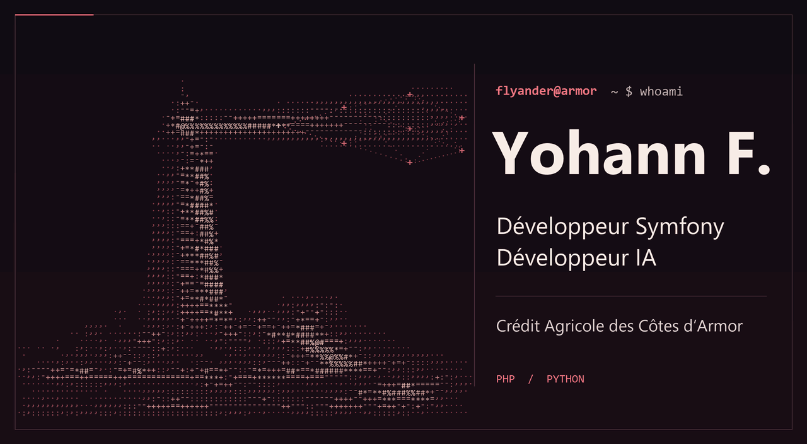
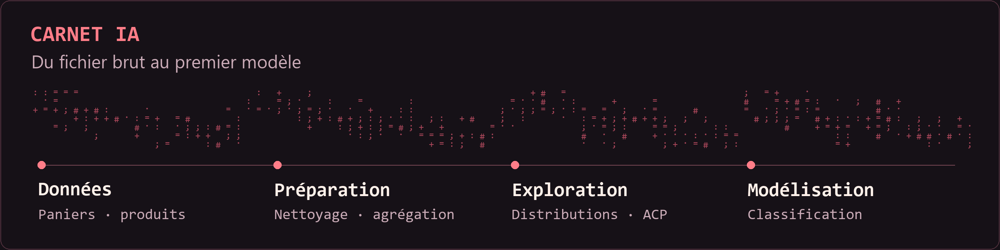
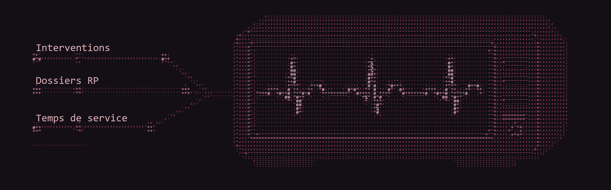

<picture>
  <source media="(prefers-reduced-motion: reduce)" srcset="https://raw.githubusercontent.com/Flyander/Flyander/main/assets/armor-rubis-atlas.png">
  
</picture>

# Développement Symfony et IA appliquée

Je suis **développeur PHP/Symfony au Crédit Agricole des Côtes d’Armor** et **développeur IA**. Côté web, je m’intéresse au trajet complet d’une requête, de l’écran jusqu’aux données. Côté IA, je travaille en Python sur la préparation des données, leur exploration et la classification.

**[Expertise](#expertise)** · **[Projets choisis](#projets-choisis)** · **[Parcours](#parcours)**

## Expertise

### Symfony en pratique

La partie web de **TregorTransport** illustre un parcours complet sous Symfony, de la route d’inscription au formulaire validé, à l’enregistrement de l’utilisateur avec Doctrine et à sa connexion.

<strong>Suivre le parcours Symfony dans le code</strong>

| Dans le code | Ce qu’on peut suivre |
| --- | --- |
| [Contrôleur d’inscription](https://github.com/Flyander/TregorTransport/blob/master/TregorTransportWebsite/src/Controller/RegistrationController.php) | Traitement de la requête, validation, hachage du mot de passe, enregistrement et ouverture de session. |
| [Type de formulaire](https://github.com/Flyander/TregorTransport/blob/master/TregorTransportWebsite/src/Form/RegistrationFormType.php) | Champs, contraintes et distinction entre le mot de passe saisi et la valeur persistée. |
| [Entité utilisateur](https://github.com/Flyander/TregorTransport/blob/master/TregorTransportWebsite/src/Entity/User.php) et [espace client](https://github.com/Flyander/TregorTransport/blob/master/TregorTransportWebsite/src/Controller/ClientController.php) | Modèle utilisateur côté données et rendu Twig côté interface. |

### Carnet IA

#### Open Food Facts · Préparer des données nutritionnelles

Comment rendre comparables des fiches produit dont certaines valeurs sont absentes, dupliquées ou aberrantes ? Le notebook documente la sélection des produits vendus en France, le nettoyage des colonnes et le traitement des valeurs manquantes. Les données sont ensuite standardisées avant une **analyse en composantes principales (ACP)**, qui aide à lire les relations entre variables nutritionnelles.

<strong>Suivre les étapes de l’analyse</strong>

- **Définir le périmètre.** Restreindre l’analyse aux produits vendus en France et écarter les colonnes peu exploitables.
- **Préparer les observations.** Repérer les doublons, examiner les valeurs extrêmes et traiter les données manquantes avant de comparer les produits.
- **Lire l’ACP.** Utiliser l’éboulis des valeurs propres, les cercles de corrélation et les plans factoriels pour interpréter la projection.

[Voir le code des graphiques](https://github.com/Flyander/OpenFood_project/blob/master/functions.py)

[Ouvrir le notebook Open Food Facts ↗](https://github.com/Flyander/OpenFood_project/blob/master/open_food_notebook.ipynb)

#### Challenge Data · Détection de fraude

Comment représenter un panier d’achat pour entraîner un classifieur ? Le premier notebook décrit la structure des données et le **déséquilibre entre les classes**. Le second explore des variables dérivées des **catégories et marques** présentes dans les paniers, puis entraîne une **forêt aléatoire** avec scikit-learn.

Avec une classe fraude minoritaire, l’exactitude globale dit peu sur la capacité à retrouver les cas qui comptent.

[Lire l’analyse de départ ↗](https://github.com/Flyander/Anti-fraude-IA/blob/master/first-research.ipynb) · [Voir le notebook de modélisation ↗](https://github.com/Flyander/Anti-fraude-IA/blob/master/score_supp_benchmark.ipynb)

## Projets choisis

### MyEMS

**Projet à la une · PHP, CodeIgniter**

 MyEMS est mon tableau de bord pour les équipes de secours en <strong>jeu de rôle</strong>. L’équipe peut répartir les interventions, retrouver le dossier d’un personnage et suivre le temps de service depuis le même espace.

[Voir MyEMS et sa démonstration](https://github.com/Flyander/MyEMS#readme)

<strong>Explorer le tableau de bord</strong>

- **Interventions.** Répartir les interventions et suivre les actions de supervision.
- **Dossiers.** Saisir, retrouver et consulter les dossiers des personnages pris en charge.
- **Service.** Suivre les prises de service, les pauses et les heures enregistrées.

[Lire le contrôleur du tableau de bord](https://github.com/Flyander/MyEMS/blob/master/application/controllers/Dashboard.php)

### Leonida

**Contribution récente · C++, Python, Direct3D 12, GitHub Actions**

 Leonida est un projet communautaire qui vise à recompiler sur PC la version Xbox de <strong>Grand Theft Auto VI</strong>. Mes contributions portent sur la compatibilité des builds Windows, les tests graphiques et l’intégration continue.

[Voir mes pull requests fusionnées](https://github.com/ItsNotRexed/Leonida/pulls?q=is%3Apr+is%3Amerged+author%3AFlyander)

<strong>Lire trois contributions fusionnées</strong>

| Contribution fusionnée | Ce que j’ai changé |
| --- | --- |
| [Compatibilité Direct3D 12 avec le SDK Windows 10.0.26100 · #2453](https://github.com/ItsNotRexed/Leonida/pull/2453) | Adapté les requêtes de capacités Direct3D 12 et partagé les définitions de compatibilité entre le runtime et les tests. |
| [File d’attente GitHub Actions · #4246](https://github.com/ItsNotRexed/Leonida/pull/4246) | Regroupé les exécutions par branche pour que les pushes récents remplacent les exécutions en attente qui sont devenues obsolètes. Une exécution déjà lancée se poursuit. |
| [Fichiers de lecture GPU · #1296](https://github.com/ItsNotRexed/Leonida/pull/1296) | Fermé les fichiers dès la fin de leur lecture pour corriger les avertissements de ressources dans les tests Python. |

### TregorTransport · Un même métier, trois interfaces

Projet d’équipe réalisé à trois autour de la gestion du transport public. Le nom vient du Trégor, en Bretagne. Le dépôt réunit un **site Symfony**, une **application mobile Xamarin** et un **outil de gestion Windows en C#**. On y voit comment un même métier se décline selon l’usage.

<strong>Explorer les trois parties du projet</strong>

- **Web.** Des écrans pour l’espace client, l’inscription et la connexion, avec Symfony et Twig. [Parcourir les contrôleurs](https://github.com/Flyander/TregorTransport/tree/master/TregorTransportWebsite/src/Controller)
- **Mobile.** Des vues dédiées au compte, à la réservation, aux trajets et à la géolocalisation. [Parcourir les vues Xamarin](https://github.com/Flyander/TregorTransport/tree/master/TregorTransportApplication/TregorTransport/TregorTransport/Vues)
- **Windows.** Des écrans de gestion pour les chauffeurs et les lignes, avec un modèle Entity Framework qui représente aussi les bus et les arrêts. [Parcourir l’application C#](https://github.com/Flyander/TregorTransport/tree/master/TregorTransportWindowsApp/PPE3)

[Voir le dépôt TregorTransport ↗](https://github.com/Flyander/TregorTransport)

## Parcours

Mon parcours passe par le développement **web, mobile et Windows**, puis par les projets de **data science en Python**. Aujourd’hui, **Symfony** est mon cadre de travail au Crédit Agricole des Côtes d’Armor. Les notebooks publics montrent l’autre versant de mon profil, de l’exploration d’un jeu de données à un premier modèle.

**Web** · PHP, Symfony, Doctrine, Twig, CodeIgniter  
**Données et IA** · Python, Jupyter, pandas, scikit-learn  
**Mobile et Windows** · C#, Xamarin, Entity Framework

---

<a href="#développement-symfony-et-ia-appliquée">↑ Revenir en haut</a> · <a href="https://github.com/Flyander?tab=repositories">Tous mes dépôts sur GitHub</a>

