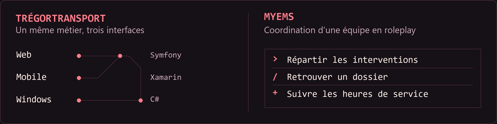

# Des applications métier à l’IA

Je suis **développeur PHP/Symfony au Crédit Agricole des Côtes d’Armor** et **développeur IA**. Mes projets publics vont d’une suite de gestion du transport à des notebooks d’analyse de données. Ce qui m’intéresse dans les deux domaines, c’est la façon dont on passe d’un besoin concret à un résultat qu’on peut utiliser et examiner.

**[Projets métier](#projets)** · **[Carnet IA](#carnet-ia)** · **[Parcours](#parcours)**

## Projets

### TregorTransport · Un même métier, trois interfaces

Projet d’équipe réalisé à trois autour de la gestion du transport public. Le nom vient du Trégor, en Bretagne. Le dépôt réunit un **site Symfony**, une **application mobile Xamarin** et un **outil de gestion Windows en C#**. On y voit comment un même métier se décline selon l’usage.

<strong>Explorer les trois parties du projet</strong>

- **Web.** Des écrans pour l’espace client, l’inscription et la connexion, avec Symfony et Twig. [Parcourir les contrôleurs](https://github.com/Flyander/TregorTransport/tree/master/TregorTransportWebsite/src/Controller)
- **Mobile.** Des vues dédiées au compte, à la réservation, aux trajets et à la géolocalisation. [Parcourir les vues Xamarin](https://github.com/Flyander/TregorTransport/tree/master/TregorTransportApplication/TregorTransport/TregorTransport/Vues)
- **Windows.** Des écrans de gestion pour les chauffeurs et les lignes, avec un modèle Entity Framework qui représente aussi les bus et les arrêts. [Parcourir l’application C#](https://github.com/Flyander/TregorTransport/tree/master/TregorTransportWindowsApp/PPE3)

[Voir le dépôt TregorTransport ↗](https://github.com/Flyander/TregorTransport)

### MyEMS · Le quotidien d’une équipe de secours en jeu de rôle

Un tableau de bord en **PHP et CodeIgniter** conçu pour le roleplay. Il rassemble la saisie et la recherche de dossiers, la répartition des interventions et le calcul des heures de service. Le projet explore la coordination d’une équipe quand plusieurs personnes travaillent sur les mêmes informations.

<strong>Voir ce que couvre le tableau de bord</strong>

- **Dossiers.** Saisir, retrouver et consulter les dossiers des personnages pris en charge.
- **Interventions.** Retrouver les actions liées à la répartition des interventions et à la supervision dans le même tableau de bord.
- **Service.** Suivre les prises de service, les pauses et les heures enregistrées.

[Lire le contrôleur du tableau de bord](https://github.com/Flyander/MyEMS/blob/master/application/controllers/Dashboard.php)

[Voir le dépôt MyEMS et sa démonstration ↗](https://github.com/Flyander/MyEMS#readme)

## Carnet IA

### Open Food Facts · Préparer des données nutritionnelles

Ce notebook part de données sur les produits alimentaires. Il documente la sélection des produits vendus en France, la suppression des doublons, l’examen des valeurs aberrantes et le traitement des valeurs manquantes. L’**analyse en composantes principales (ACP)** permet ensuite d’explorer les relations entre les variables nutritionnelles.

[Ouvrir le notebook Open Food Facts ↗](https://github.com/Flyander/OpenFood_project/blob/master/open_food_notebook.ipynb)

### Challenge Data · Détection de fraude

Un exercice de classification à partir de paniers d’achat. Le notebook de recherche décrit les données et le déséquilibre entre les classes. Le second notebook explore une représentation des paniers à partir des **catégories de produits et des marques**, puis entraîne une **forêt aléatoire** avec scikit-learn.

[Lire l’analyse de départ ↗](https://github.com/Flyander/Anti-fraude-IA/blob/master/first-research.ipynb) · [Voir le notebook de modélisation ↗](https://github.com/Flyander/Anti-fraude-IA/blob/master/score_supp_benchmark.ipynb)

## Parcours

Mon parcours passe par le développement **web, mobile et Windows**, puis par les projets de **data science en Python**. Aujourd’hui, **Symfony** est mon cadre de travail au Crédit Agricole des Côtes d’Armor. Les notebooks publics montrent l’autre versant de mon profil, de l’exploration d’un jeu de données à un premier modèle.

**Web** · PHP, Symfony, Twig, CodeIgniter  
**Données et IA** · Python, Jupyter, pandas, scikit-learn  
**Mobile et Windows** · C#, Xamarin, Entity Framework

---

<a href="#des-applications-métier-à-lia">↑ Revenir en haut</a> · <a href="https://github.com/Flyander?tab=repositories">Tous mes dépôts sur GitHub</a>

