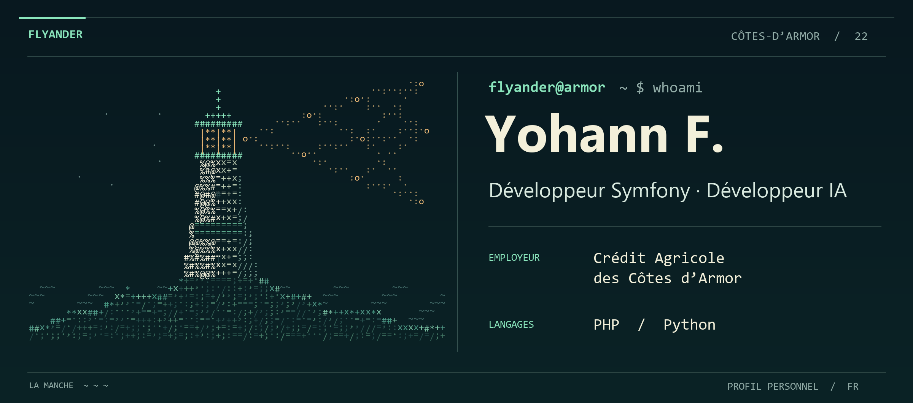

Je développe en **PHP avec Symfony** au Crédit Agricole des Côtes d’Armor. Je suis également **développeur IA**.

### Quelques réalisations publiques

**[MyEMS](https://github.com/Flyander/MyEMS)** · PHP / CodeIgniter  
Une application qui permet à une équipe médicale de saisir et de retrouver les dossiers de ses patients.

**[TregorTransport](https://github.com/Flyander/TregorTransport)** · C# / Web / Mobile  
Trois interfaces pour la gestion du transport public, sur le web, sur mobile et sous Windows.

**[Leonida · correctif nº 1296](https://github.com/ItsNotRexed/Leonida/pull/1296)** · Python  
Une contribution ciblée sur la gestion des ressources. Le correctif ferme les fichiers de lecture GPU dès que leur contenu a été lu.
